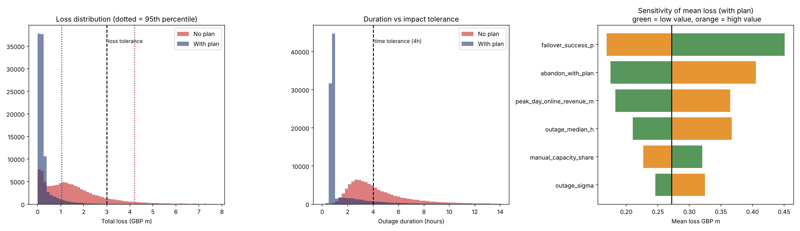

# Monte Carlo disruption simulation

> Simulate a peak-trading outage against impact tolerances and test how much a continuity plan reduces risk (illustrative assumptions).




**Scenario.** Online checkout outage during peak trading week.

**Questions.** How large could the loss be, how likely is the outage to exceed our impact tolerance, and how much risk does
the continuity plan remove?

**Approach.** 100,000 simulated outages: random start time (loss depends on the hourly demand profile), lognormal duration (fat tail),
customer abandonment, goodwill compensation, and two policies: no plan vs plan (faster detection and decisions, a warm failover that works 75% of the time,
a manual ordering channel, customer comms). Impact tolerance assumed at 4 hours and GBP 3m. **Every input is an illustrative assumption**
listed in one block at the top of the script so a reviewer can challenge it.

**Results (illustrative).**
| | No plan | With plan |
|---|---|---|
| Mean loss | GBP 1.58m | GBP 0.27m |
| 95th percentile loss | GBP 4.20m | GBP 1.04m |
| Chance outage exceeds 4h tolerance | 46% | 8% |
| Chance loss exceeds GBP 3m tolerance | 13% | 0.4% |

Sensitivity: the result depends most on whether the failover actually works (75% assumed), then on abandonment and on peak-day revenue. Failover reliability is the assumption to test, not trust.

**What I would tell leadership.** The plan is worth much more than its cost only if the failover has been tested. Run a live failover
exercise before peak and track the failover success rate as a KRI.

**Limitations.** Revenue, abandonment and failover figures are assumptions, not data, so absolute GBP values are not predictions.
The value is in comparing options and showing which assumptions matter. Replace the inputs with real BIA and incident history.

Files: `disruption_montecarlo.py`, `montecarlo_results.png`, `simulation_summary.csv`, `sensitivity.csv`.

## Run it
```
pip install -r requirements.txt
python3 disruption_montecarlo.py
```
Fixed random seeds, so results reproduce exactly. All data is synthetic or assumption-based; no real company data is used.

Part of a series of data-driven risk and operational resilience projects by Suhas Suresha.
